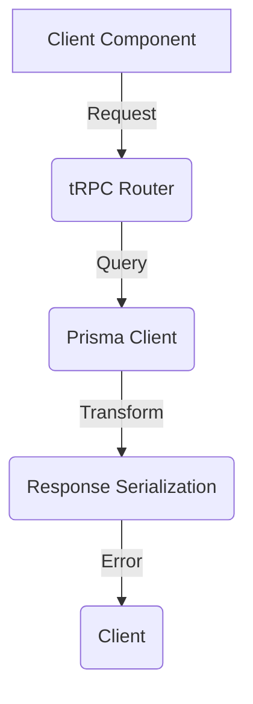

# Word Management Error Resolution Plan

## Error Analysis
1. **Root Cause**: Serialization error in tRPC procedure `vocab.listByBank`
2. **Symptoms**:
   - Failed to serialize function in Prisma query
   - Error occurs when fetching words for a word bank
   - Affects components: WordList, LearnWords, [bankId]/page

## Verification Steps

### 1. Validate Data Flow


### 2. Check Points
1. [ ] Verify Prisma schema matches query structure
2. [ ] Check tRPC procedure input/output types
3. [ ] Validate transformation function
4. [ ] Test with minimal query

## Resolution Strategy

### Phase 1: Isolation
1. Create test endpoint with minimal query
2. Gradually add fields until error reproduces
3. Identify exact field causing serialization issue

### Phase 2: Type Safety
1. Define strict input/output types for:
   - `WordListItem`
   - `WordMaster`
   - `PracticeLogCount`
2. Add runtime validation with Zod

### Phase 3: Implementation
1. Fix transformation in `listByBank`:
   ```ts
   return words.map(word => ({
     ...cleanFields,
     wordBankId: word.wordBank.id,
     practiceCount: word._count.practiceLogs
   }));
   ```
2. Add type guards for JSON fields
3. Implement proper serialization for dates

### Phase 4: Testing
1. Unit tests for transformation
2. Integration test for full flow
3. E2E test in affected components

## Affected Files
1. `src/server/api/routers/vocab.ts` (Primary fix)
2. `src/schemas/vocab.schema.ts` (Type definitions)
3. `src/components/features/vocab/WordList.tsx` (Consumer)
4. `src/app/vocabulary/banks/[bankId]/page.tsx` (Consumer)

## Timeline
1. Immediate: Fix serialization error (1h)
2. Short-term: Add type safety (2h)
3. Ongoing: Monitoring and validation

## Verification
1. Test cases:
   - Empty word bank
   - Bank with 100+ words
   - Special characters in word text
   - Missing optional fields
